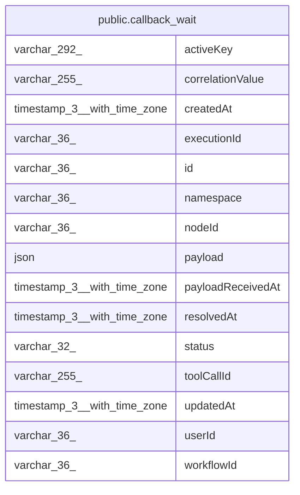

# public.callback_wait

## Columns

| Name | Type | Default | Nullable | Children | Parents | Comment |
| ---- | ---- | ------- | -------- | -------- | ------- | ------- |
| activeKey | varchar(292) |  | true |  |  | namespace:correlationValue while live, NULL once resolved |
| correlationValue | varchar(255) |  | false |  |  | External correlation id, normalised to its string form |
| createdAt | timestamp(3) with time zone | CURRENT_TIMESTAMP(3) | false |  |  |  |
| executionId | varchar(36) |  | true |  |  | NULL while the row is only a parked callback |
| id | varchar(36) |  | false |  |  |  |
| namespace | varchar(36) |  | false |  |  | Webhook registration that owns the endpoint receiving the callback |
| nodeId | varchar(36) |  | true |  |  |  |
| payload | json |  | true |  |  | Callback body only; headers and query are never stored here |
| payloadReceivedAt | timestamp(3) with time zone |  | true |  |  |  |
| resolvedAt | timestamp(3) with time zone |  | true |  |  |  |
| status | varchar(32) |  | false |  |  |  |
| toolCallId | varchar(255) |  | true |  |  |  |
| updatedAt | timestamp(3) with time zone | CURRENT_TIMESTAMP(3) | false |  |  |  |
| userId | varchar(36) |  | true |  |  |  |
| workflowId | varchar(36) |  | true |  |  |  |

## Constraints

| Name | Type | Definition |
| ---- | ---- | ---------- |
| PK_4f1a5f95d93a75a51a8fb3f46b5 | PRIMARY KEY | PRIMARY KEY (id) |
| callback_wait_correlationValue_not_null | n | NOT NULL "correlationValue" |
| callback_wait_createdAt_not_null | n | NOT NULL "createdAt" |
| callback_wait_id_not_null | n | NOT NULL id |
| callback_wait_namespace_not_null | n | NOT NULL namespace |
| callback_wait_status_not_null | n | NOT NULL status |
| callback_wait_updatedAt_not_null | n | NOT NULL "updatedAt" |

## Indexes

| Name | Definition |
| ---- | ---------- |
| IDX_callback_wait_executionId | CREATE INDEX "IDX_callback_wait_executionId" ON public.callback_wait USING btree ("executionId") |
| IDX_callback_wait_namespace_correlationValue | CREATE INDEX "IDX_callback_wait_namespace_correlationValue" ON public.callback_wait USING btree (namespace, "correlationValue") |
| PK_4f1a5f95d93a75a51a8fb3f46b5 | CREATE UNIQUE INDEX "PK_4f1a5f95d93a75a51a8fb3f46b5" ON public.callback_wait USING btree (id) |
| uq_callback_wait_active_key | CREATE UNIQUE INDEX uq_callback_wait_active_key ON public.callback_wait USING btree ("activeKey") WHERE ("activeKey" IS NOT NULL) |

## Relations

---

> Generated by [tbls](https://github.com/k1LoW/tbls)
