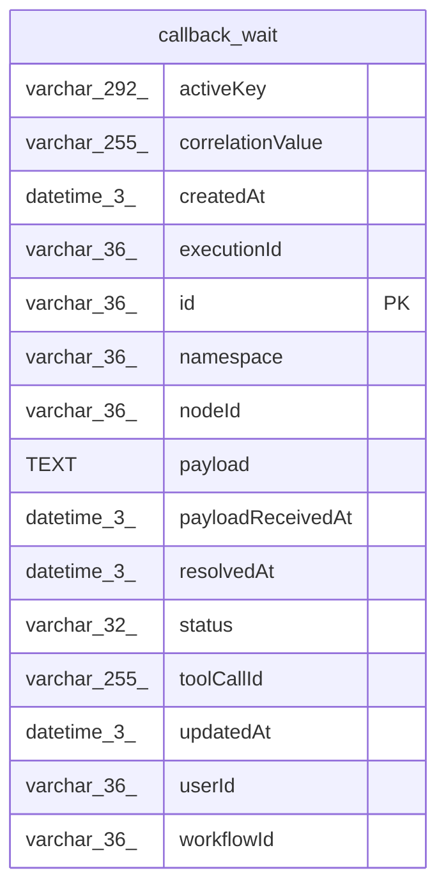

# callback_wait

## Description

<details>
<summary><strong>Table Definition</strong></summary>

```sql
CREATE TABLE "callback_wait" ("id" varchar(36) PRIMARY KEY NOT NULL, "namespace" varchar(36) NOT NULL, "correlationValue" varchar(255) NOT NULL, "activeKey" varchar(292), "status" varchar(32) NOT NULL, "executionId" varchar(36), "toolCallId" varchar(255), "nodeId" varchar(36), "workflowId" varchar(36), "payload" text, "payloadReceivedAt" datetime(3), "resolvedAt" datetime(3), "createdAt" datetime(3) NOT NULL DEFAULT (STRFTIME('%Y-%m-%d %H:%M:%f', 'NOW')), "updatedAt" datetime(3) NOT NULL DEFAULT (STRFTIME('%Y-%m-%d %H:%M:%f', 'NOW')), "userId" varchar(36))
```

</details>

## Columns

| Name | Type | Default | Nullable | Children | Parents | Comment |
| ---- | ---- | ------- | -------- | -------- | ------- | ------- |
| activeKey | varchar(292) |  | true |  |  |  |
| correlationValue | varchar(255) |  | false |  |  |  |
| createdAt | datetime(3) | STRFTIME('%Y-%m-%d %H:%M:%f', 'NOW') | false |  |  |  |
| executionId | varchar(36) |  | true |  |  |  |
| id | varchar(36) |  | false |  |  |  |
| namespace | varchar(36) |  | false |  |  |  |
| nodeId | varchar(36) |  | true |  |  |  |
| payload | TEXT |  | true |  |  |  |
| payloadReceivedAt | datetime(3) |  | true |  |  |  |
| resolvedAt | datetime(3) |  | true |  |  |  |
| status | varchar(32) |  | false |  |  |  |
| toolCallId | varchar(255) |  | true |  |  |  |
| updatedAt | datetime(3) | STRFTIME('%Y-%m-%d %H:%M:%f', 'NOW') | false |  |  |  |
| userId | varchar(36) |  | true |  |  |  |
| workflowId | varchar(36) |  | true |  |  |  |

## Constraints

| Name | Type | Definition |
| ---- | ---- | ---------- |
| id | PRIMARY KEY | PRIMARY KEY (id) |
| sqlite_autoindex_callback_wait_1 | PRIMARY KEY | PRIMARY KEY (id) |

## Indexes

| Name | Definition |
| ---- | ---------- |
| IDX_callback_wait_executionId | CREATE INDEX "IDX_callback_wait_executionId" ON "callback_wait" ("executionId")  |
| IDX_callback_wait_namespace_correlationValue | CREATE INDEX "IDX_callback_wait_namespace_correlationValue" ON "callback_wait" ("namespace", "correlationValue")  |
| sqlite_autoindex_callback_wait_1 | PRIMARY KEY (id) |
| uq_callback_wait_active_key | CREATE UNIQUE INDEX "uq_callback_wait_active_key" ON "callback_wait" ("activeKey") WHERE "activeKey" IS NOT NULL |

## Relations



---

> Generated by [tbls](https://github.com/k1LoW/tbls)
